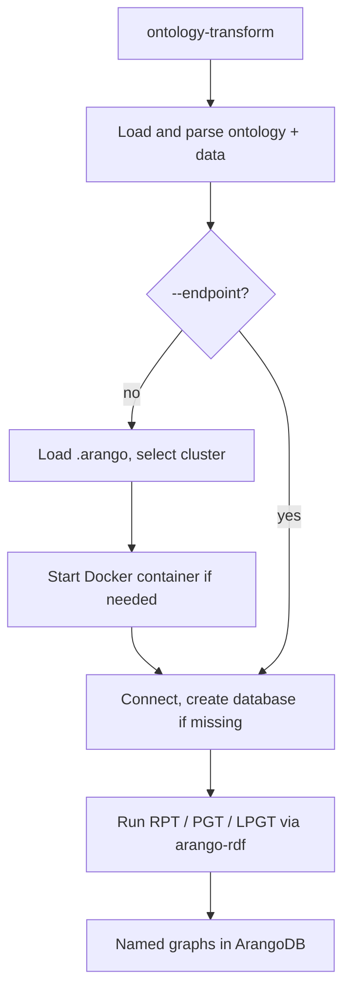

# Project Structure

This repository is intentionally small. The code lives in the `ontology_graph_generator` package. Documentation, tests, examples, CI, and packaging metadata sit at the repository root.

## Repository Layout

```text
ontology-driven-arango-graph-generator/
├── .arango.example                  # Safe sample cluster configuration
├── .github/workflows/ci.yml         # Lint, tests, live ArangoDB tests, secret scan
├── CHANGELOG.md                     # Release notes
├── CONTRIBUTING.md                  # Contributor setup and PR guidance
├── LICENSE                          # MIT license
├── README.md                        # Project overview and quick start
├── SECURITY.md                      # Vulnerability reporting guidance
├── docker-compose.yml               # Local ArangoDB development service
├── pyproject.toml                   # Packaging, dependencies, lint, and test config
├── docs/                            # User and maintainer documentation
├── examples/                        # Small ontology and sample data for the quick start
├── ontology_graph_generator/
│   ├── arango_credentials.py        # .arango loader, Docker helpers, secret masking
│   ├── transformer.py               # Ontology loading and arango-rdf transformations
│   ├── cli.py                       # `ontology-transform` command
│   └── environment.py               # `ontology-env` command
└── tests/                           # Unit, documentation, and integration tests
```

## Data Flow



## Security Model

- `.arango` is ignored by git and is the only intended place for stored credentials. `password_env` lets a cluster read its password from the environment instead.
- Passwords are never accepted as command-line flags.
- Connection output masks passwords with a fixed-width mask.
- CI scans the full git history with gitleaks.

## Test Strategy

- `tests/test_arango_credentials.py`, `tests/test_transformer.py`, `tests/test_cli.py`: unit tests with no database or Docker required.
- `tests/test_docs.py`: relative links resolve and documented CLI flags exist.
- `tests/test_integration.py`: runs all patterns against a live ArangoDB. It is skipped unless `ARANGO_TEST_ENDPOINT` is set; CI runs it against an ArangoDB service container.

## Extension Points

- New patterns: add an entry to `PATTERNS` in `transformer.py`. The CLI choices, tests, and docs follow from it.
- New credential sources: extend `ArangoCredentialManager.get_password` without writing secrets to disk or output.
