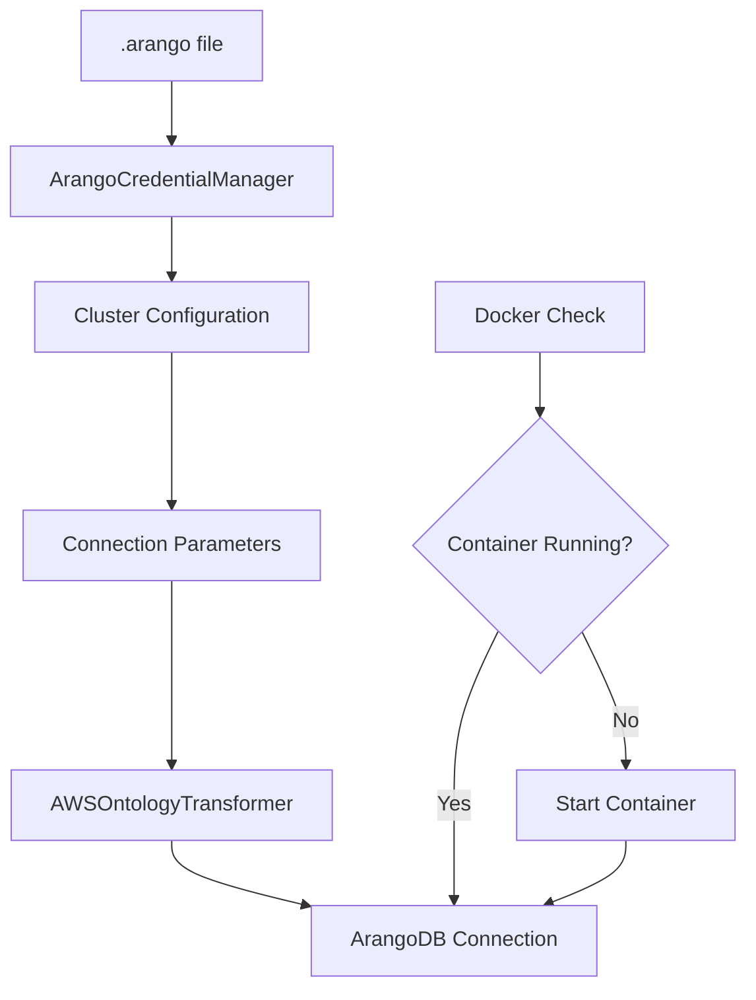
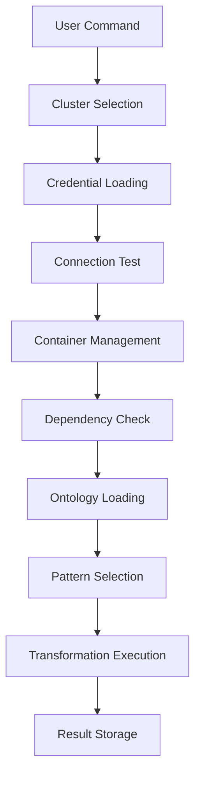

# Project Structure - Ontology-Driven ArangoDB Graph Generator

Complete overview of the project structure, files, and their purposes.

## 📁 Repository Structure

```
ontology-driven-arango-graph-generator/
├── 📄 README.md                    # Main project documentation
├── 📄 requirements.txt             # Python dependencies
├── 📄 .gitignore                   # Git ignore rules (includes .arango)
├── 📄 .arango                      # Cluster credentials (user-created, git-ignored)
├── 📄 INTEGRATION_SUMMARY.md       # Implementation summary
│
├── 🛠️  tools/                       # Transformation and management tools
│   ├── 📄 README.md                # Tools documentation
│   ├── 🐍 transform_ontology.py    # Main transformation tool
│   ├── 🐍 arango_credentials.py    # Credential management system
│   ├── 🐍 setup_environment.py     # Environment validation & setup
│   ├── 🐍 demo_cluster_management.py # Cluster management demo
│   ├── 🐍 quick_start.py          # Complete capability demonstration
│   └── 🐍 test_credentials.py      # Basic credential testing
│
├── 📚 docs/                        # Comprehensive documentation
│   ├── 📄 CLUSTER_MANAGEMENT.md    # Cluster configuration guide
│   ├── 📄 API_REFERENCE.md         # Complete API reference
│   └── 📄 PROJECT_STRUCTURE.md     # This file
│
├── 🏗️  automation/                 # Automation scripts (existing)
├── 🚀 deployment/                  # Deployment configurations (existing)
├── 📝 examples/                    # Usage examples (existing)
├── 🔄 pipelines/                   # Data pipelines (existing)
├── 🔍 queries/                     # AQL query examples (existing)
├── 📋 schemas/                     # Database schemas (existing)
└── 🧪 tests/                       # Test suites (existing)
```

## 🔧 Core Files

### Configuration & Setup

#### `.arango` - Cluster Credentials Configuration
**Location:** Project root  
**Type:** YAML configuration file  
**Purpose:** Stores ArangoDB cluster credentials and connection details  
**Security:** ⚠️ **Git-ignored** - contains sensitive information  

**Example:**
```yaml
clusters:
  local:
    type: "docker"
    name: "Local Development"
    container_name: "arango"
    endpoint: "http://localhost:8529"
    username: "root"
    password: "password"

default: "local"
```

#### `requirements.txt` - Python Dependencies
**Purpose:** Defines all required Python packages  
**Key additions for credential management:**
- `PyYAML>=6.0` - Configuration parsing
- `python-arango>=7.5.0` - ArangoDB client
- `arangordf>=0.1.0` - RDF transformation engine

#### `.gitignore` - Git Ignore Rules
**Key entries for security:**
```
# ArangoDB credentials file - contains sensitive information
.arango
```

### Documentation Files

#### `README.md` - Main Project Documentation
**Content:**
- 🚀 Quick start with cluster management
- 🔧 Cluster configuration examples
- 🚀 Updated usage examples
- 📋 Feature overview

#### `INTEGRATION_SUMMARY.md` - Implementation Summary
**Purpose:** Complete summary of the credential integration implementation  
**Content:**
- ✅ Completed features breakdown
- 🛠️ Core components overview
- 📋 Usage examples
- 🔒 Security features

## 🛠️ Tools Directory

### Primary Tools

#### `transform_ontology.py` - Main Transformation Tool
**Purpose:** Core transformation engine with cluster-based authentication  
**Key Features:**
- 🔗 Cluster-based connection management
- 🐳 Automatic Docker container handling
- 🧪 Connection testing capabilities
- 📦 Dependency validation
- 🔄 Multiple transformation patterns (RPT, PGT, LPGT)

**Command Categories:**
```bash
# Cluster Management
--list-clusters
--test-connection
--start-container

# Transformation
--patterns [rpt|pgt|lpgt]
--cluster <name>

# Setup
--setup-deps
```

#### `arango_credentials.py` - Credential Management System
**Purpose:** Core credential management and cluster operations  
**Key Classes:**
- `ArangoCredentialManager` - Main credential handling class

**Key Features:**
- 📁 YAML configuration parsing
- 🔒 Secure credential handling
- 🐳 Docker container lifecycle management
- 🌐 Cloud cluster support
- 🔍 Connection parameter extraction

#### `setup_environment.py` - Environment Setup & Validation
**Purpose:** Comprehensive environment validation and dependency installation  
**Validation Checks:**
- ✅ Python version compatibility (3.8+)
- ✅ Docker availability and daemon status
- ✅ Configuration file existence
- ✅ Core dependency availability
- ✅ Optional dependency detection

**Installation Features:**
- 🔧 Automatic dependency installation
- 🛡️ Externally managed environment handling
- 📋 Clear error messages and guidance

### Support Tools

#### `demo_cluster_management.py` - Cluster Management Demo
**Purpose:** Standalone cluster management operations  
**Use Cases:**
- 🧪 Testing cluster connections
- 🐳 Manual container management
- 📋 Cluster status inspection
- 🎓 Learning cluster operations

#### `quick_start.py` - Complete Demonstration
**Purpose:** Comprehensive capability showcase  
**Demonstrates:**
- 📦 Environment setup process
- 🔧 Cluster management operations
- 🧪 Connection testing workflows
- 🐳 Container management
- 🔄 Transformation examples

#### `test_credentials.py` - Basic Credential Testing
**Purpose:** Simple credential manager validation  
**Tests:**
- 📁 Configuration file loading
- 📋 Cluster listing
- 🔗 Default cluster access
- 🐳 Docker status checking

## 📚 Documentation Directory

### User Guides

#### `CLUSTER_MANAGEMENT.md` - Cluster Configuration Guide
**Purpose:** Comprehensive cluster management documentation  
**Content:**
- 🔧 Configuration file format details
- 🏗️ Cluster type explanations (Docker vs Cloud)
- 🛠️ Cluster operation procedures
- 🔒 Security best practices
- 🎯 Configuration examples
- 🆘 Troubleshooting guide

#### `API_REFERENCE.md` - Complete API Reference
**Purpose:** Technical reference for all tools and APIs  
**Content:**
- 🛠️ Command-line tool documentation
- 📁 Configuration file specifications
- 🐍 Python API documentation
- 📦 Dependency information
- 🔍 Error codes and messages
- 🎯 Usage patterns

#### `PROJECT_STRUCTURE.md` - This File
**Purpose:** Repository organization and file purpose documentation

## 🔄 Data Flow

### Credential Management Flow



### Transformation Flow



## 🔒 Security Architecture

### Credential Isolation

```
User Workspace
├── .arango (git-ignored)    # Sensitive credentials
├── source code (tracked)    # No credentials
└── .gitignore              # Protects .arango
```

### Access Control Flow

1. 📁 **Configuration Loading** - Credentials read from `.arango`
2. 🔒 **Password Masking** - All outputs mask sensitive data
3. 🔐 **Connection Security** - SSL auto-detected from URLs
4. 🛡️ **Environment Isolation** - Separate configs per environment

## 🧩 Integration Points

### External Dependencies

#### ArangoDB Integration
- **Client Library:** `python-arango`
- **Transformation Engine:** `arangordf`
- **Connection Methods:** Direct TCP, Docker, Cloud

#### Docker Integration
- **Container Management:** `docker` CLI commands
- **Status Detection:** Container inspection
- **Lifecycle Control:** Start/stop operations

#### Configuration Management
- **Format:** YAML (PyYAML)
- **Validation:** Schema checking
- **Security:** File-based isolation

### Internal Architecture

#### Component Dependencies
```
transform_ontology.py
├── arango_credentials.py (credential management)
├── setup_environment.py (environment validation)
└── External Libraries (rdflib, python-arango, arangordf)

demo_cluster_management.py
└── arango_credentials.py

setup_environment.py
└── System Dependencies (Python, Docker, pip)
```

## 📈 Usage Patterns

### Development Workflow
1. 🔧 **Setup:** `python tools/setup_environment.py --install-deps`
2. 📋 **Explore:** `python tools/transform_ontology.py --list-clusters`
3. 🧪 **Test:** `python tools/transform_ontology.py --cluster local --test-connection`
4. 🔄 **Transform:** `python tools/transform_ontology.py --cluster local --patterns pgt`

### Production Deployment
1. 🔧 **Environment:** Configure production `.arango` file
2. 🧪 **Validation:** Test all cluster connections
3. 🚀 **Deploy:** Run transformations with production clusters
4. 📊 **Monitor:** Use connection testing for health checks

### Multi-Environment Management
1. 🏗️ **Configure:** Set up dev/staging/prod clusters in `.arango`
2. 🔄 **Switch:** Use `--cluster` parameter for environment selection
3. 🧪 **Test:** Validate each environment before operations
4. 🔒 **Secure:** Use different credentials per environment

## 🔮 Future Extensibility

### Plugin Architecture Ready
- **Credential Providers:** Easily add new authentication methods
- **Container Engines:** Support for Kubernetes, Podman, etc.
- **Cloud Providers:** Additional cloud service integrations

### Configuration Extensions
- **Environment Variables:** Override configuration values
- **External Secrets:** Integration with secret management systems
- **Dynamic Discovery:** Automatic cluster detection

### Tool Ecosystem
- **Monitoring Tools:** Cluster health and performance monitoring
- **Backup Tools:** Automated backup and restore procedures
- **Migration Tools:** Data migration between clusters

---

For getting started: `python tools/quick_start.py`  
For cluster setup: [CLUSTER_MANAGEMENT.md](CLUSTER_MANAGEMENT.md)  
For API details: [API_REFERENCE.md](API_REFERENCE.md)