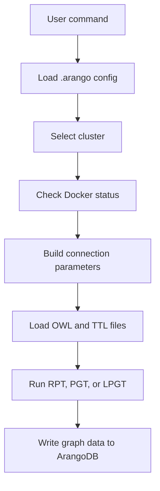

# Project Structure

This repository is intentionally small. The core code lives in `tools/`, with documentation, tests, CI, and packaging metadata at the repository root.

## Repository Layout

```text
ontology-driven-arango-graph-generator/
├── .arango.example              # Safe sample cluster configuration
├── .github/workflows/ci.yml     # Public CI checks
├── CONTRIBUTING.md              # Contributor setup and PR guidance
├── INTEGRATION_SUMMARY.md       # Summary of cluster integration
├── LICENSE                      # MIT license
├── README.md                    # Project overview and quick start
├── SECURITY.md                  # Vulnerability reporting guidance
├── docker-compose.yml           # Local ArangoDB development service
├── pyproject.toml               # Packaging, dependencies, lint, and test config
├── requirements.txt             # Simple pip requirements mirror
├── docs/                        # User and maintainer documentation
├── tests/                       # Portable pytest suite
└── tools/                       # CLI scripts and helper modules
```

## Core Tooling

- `tools/transform_ontology.py`: main CLI for cluster selection, connection testing, and RPT/PGT/LPGT transformations.
- `tools/arango_credentials.py`: `.arango` YAML loader and cluster helper.
- `tools/setup_environment.py`: environment and dependency validation.
- `tools/demo_cluster_management.py`: standalone cluster management demo.
- `tools/quick_start.py`: guided workflow demonstration.
- `tools/validate_documentation.py`: repository documentation sanity checks.

## Data Flow



## Security Model

- `.arango` is ignored by git and is the only intended place for real ArangoDB credentials.
- `.arango.example` contains only placeholders and local-development defaults.
- CLI output masks passwords when connection details are displayed.
- Public documentation must use fictional hosts such as `example.arangodb.cloud`.

## Test Strategy

- Unit tests in `tests/` verify configuration loading, password masking behavior, CLI help, and documentation validation.
- Live ArangoDB transformations are manual or opt-in because they require credentials and ontology input files.
- CI runs portable checks that do not depend on a private database.

```bash
pytest
python tools/validate_documentation.py
```

## Extension Points

- Add new credential providers behind `ArangoCredentialManager` only when they can preserve local secret isolation.
- Add new transformation patterns in `OntologyGraphTransformer` with explicit CLI choices and tests.
- Keep documentation examples generic and safe for public repositories.
